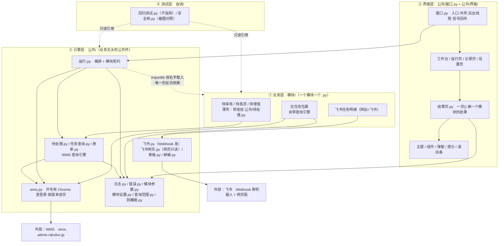

# 仓库助手 · 架构说明

> 只讲**程序是怎么搭起来的**。界面规矩/说话方式见 `CLAUDE.md`，怎么装怎么用见 `使用说明.txt`，每个模块查什么见 `模块清单.md`。
> 基线：提交 `c1f9c3e`（2026-10-31）。`模块/` + `公共/` + `自测/` 共 39 个 .py、9862 行（含 2 个空的 `__init__.py`；不含 `工具/` 里的 Python）；标识符、文件名、注释全是中文。
> 硬约束：**全程只读**——只查 WMS 和飞书，不提交、不修改、不删除任何业务数据。

## 1. 分层与依赖

四层，箭头 = "谁依赖谁"（上层依赖下层）。**模块契约**指一个模块文件必须提供的函数和返回值格式，像插座规格——引擎只认插座，不认具体模块。



- **① 业务层**：只负责"查什么、怎么算状态、结果长什么样"。**不**碰窗口、**不**发飞书、**不**写日志——发飞书和写日志都是引擎的 `收尾()` 干的（`公共/运行.py:100`）。
- **② 界面层**：只负责"画"和"把点击变成信号"。**不**查 WMS、**不**算业务数字；结果页拿到的已经是排好的 `表们 / 分组 / 面单`（`公共/结果页.py:1002`）。
- **③ 引擎层**：只负责"怎么操作网页、怎么记日志、怎么读设置"。**不知道**什么是"待审核"，靠契约调用业务层。
- **④ 测试层**：只被手动运行，不参与运行时；`回归测试.py` 不连网、不发飞书。
- **外部系统**：WMS 只经 `公共/wms.py` 用 Playwright（一个让程序操作真 Chrome 的库）打开**专用** Chrome，复用 `浏览器配置\` 里的登录状态（`公共/wms.py:15`）；飞书两条路——发消息走 Webhook（`公共/飞书.py`），读任务走网页只读（`公共/飞书网页.py`）。
- **唯一的反向箭头**：`运行.py` 用 `importlib` 按文件名载入模块并当场查契约（`公共/运行.py:47`、`:36`）。这是"引擎不 import 具体模块"的代价，也是加新模块不用改引擎的原因。`公共/界面/弹窗.py:182` 也这么读一次（取 默认参数 / 可发飞书 / 说明）。
- **依赖纪律**：`模块/` 里没有任何文件 import `公共/界面/`；`公共/` 里没有任何文件 import `模块/`（只有上面两处 importlib 字符串）。

## 2. 一次运行发生了什么

按时间顺序，每步开头是"谁在做"（窗口线程 / 后台线程）。

1. **窗口线程**：点"运行已启用模块" → 工作台发 `运行请求` 信号（`公共/界面/工作台.py:306`）→ `主窗口.开始运行`（`公共/窗口.py:229`）。
2. **窗口线程**：三个前置拦截——已经在跑就返回；模块列表为空就弹提示；`专用窗口开着()` 就让人先关掉专用 Chrome（`公共/窗口.py:230`）。
3. **窗口线程**：`运行中 = True`、禁用工作台、`运行页.开始()`、切到结果页、把 `运行记录.观察者` 设成"把日志行转发成 Qt 信号"的 lambda、在窗口线程里**先读好**总开关的值（`公共/窗口.py:238`–`:246`）。
4. **窗口线程**：`threading.Thread(target=self._后台运行, daemon=True).start()`——查询全在后台线程跑，窗口不卡（`公共/窗口.py:247`）。
5. **后台线程**：调 `运行模块们(名列表, 发送=…, 显示=False, 等待登录=…, 回报=…, 选择=…)`（`公共/窗口.py:252`）。
6. **后台线程**：`任务查询.新的一次运行()` 把查询间隔重置成 1 秒；多个模块时先建"主控"记录；把 `运行记录.本次主控 / 正在` 写进全局（`公共/运行.py:78`、`:82`、`:83`）。
7. **后台线程**：`载入模块()` 逐个 import 并查契约；算出"不跑"（查询范围一项没勾）和"需要 WMS"（`公共/运行.py:178`–`:181`）。
8. **后台线程**：`防睡眠.开始()`；开 Playwright，按需 `打开WMS()`（含登录检查，掉线时经 `等待登录` 回调请窗口弹窗）或只 `启动浏览器()`（纯飞书模块）（`公共/运行.py:182`–`:202`）。
9. **后台线程**：逐模块循环——通知"开始模块"→ 建/取运行记录 → `运行记录.正在 = 记录` → 多个模块时先回 WMS 首页刷新（`公共/运行.py:206`–`:236`）。
10. **后台线程**：`模块.运行(页面, 记录, 参数)`；`需要选择=True` 的模块多收一个 `选择` 参数（`公共/运行.py:237`–`:240`）。
11. **后台线程**：`自动化错误` → `模块.失败结果()`；其它异常 → 先 `保存现场()` 再 `归类()` 成中文（`公共/运行.py:241`–`:249`）。碰到 `立刻停下` 类错误（账号被挤 / WMS 弹提示）记下，后面模块一律不跑（`公共/运行.py:250`）。
12. **后台线程**：`收尾()`——`组成消息()` → 加【测试】前缀 → 五道判断决定发不发飞书（`未运行 / 本次不发送 / 模块不可发 / 设置不发 / 飞书没配好`）→ 发送 → **算变化、记快照**（模块写了可选成员 `快照`、且状态不是"未运行"时：`追踪.算变化` 比上次 → `追踪.记快照` 写一行 → `追踪.追Excel` 追加两张表；整体包在 try 里，出错只写一行日志，不影响结果和状态）→ `记录.结束()` 写 `运行总表.csv` → 组装成"项"（带 `"变化"`）（`公共/运行.py:100`–`:180`）。
13. **后台线程 → 窗口线程**：`通知("模块结果", 项)` → `传话.模块结果` 信号（Qt 自动排队到窗口线程）→ `_模块结果()` → `运行页.显示一个()` → `结果页.一页()` 画到右边，同时存进"上一次的结果"（`公共/窗口.py:283`、`公共/界面/运行页.py:290`、`公共/结果页.py:1016`）。
14. **后台线程**：全部跑完 `浏览器.close()`；`finally` 里清 `运行记录.正在`、`防睡眠.恢复()`；有主控就写汇总摘要；返回 `{"结果们", "消息们", "日志文件夹"}`（`公共/运行.py:259`、`:270`、`:276`、`:289`）。
15. **后台线程 → 窗口线程**：`全部完成` 信号 → `_全部完成()`：解除禁用、存上次结果、`运行页.全部完成()`（进度补满、选中有问题的那一个）、`工作台.刷新模块()` 更新卡片数字、飞书没发成功就弹警告（`公共/窗口.py:299`–`:318`）。

## 3. 模块契约

**必需 5 个成员**（缺一个载入时立刻报"缺少 运行、组成消息"，不会等跑完才报——`公共/运行.py:36`、`:39`）：

| 成员 | 类型 | 职责 | 出处 |
|---|---|---|---|
| `模块名` | 字符串 | 中文名，**必须等于文件名**（"原名"，固定）；显示名可在窗口改 | `模块/_模板.py:7` |
| `默认参数` | dict | 例如 `{"查询范围": ["瑞江仓库"], "发到飞书": True}` | `模块/_模板.py:8` |
| `运行(页面, 记录, 参数)` | 函数 | 查数据，返回结果字典；查不到就抛 `自动化错误`，**绝不返回 0** | `模块/_模板.py:9` |
| `失败结果(错误, 开始时间, 参数)` | 函数 | 还没开始查就失败时给一份"失败"结果 | `模块/_模板.py:10` |
| `组成消息(结果, 文件夹名, 用时)` | 函数 | 返回 `(消息, 格式问题)`；格式问题非空时写进日志 | `模块/_模板.py:11` |

**可选 5 个**（不写就用默认值）：

| 成员 | 默认 | 作用 | 出处 |
|---|---|---|---|
| `说明` | 空 | 工作台卡片上那句用途 | `模块/_模板.py:14` |
| `网站` | `"WMS"` | 写 `"飞书"` 就不打开 WMS、不检查 WMS 登录 | `公共/运行.py:181` |
| `需要选择` | `False` | `True` 时 `运行()` 多收一个 `选择` 参数（运行中弹窗勾选） | `公共/运行.py:237` |
| `可发飞书` | `True` | `False` = 只在窗口里看，界面上不给"发到飞书"按钮 | `公共/运行.py:146` |
| `快照(结果)` | 没有 = 这个模块不追踪变化 | 返回 `{"日期框": 按哪个时间分日期（没有日期写 ""）, "格们": [每个 类×区 一格]}`；**只放数字，不存单号**。引擎只认这个名字，不 import 具体模块（2026-11-01） | `公共/追踪.py`、`公共/待处理.py:407` |

**结果字典的 5 个键**（`模块/_模板.py:19`）：

| 键 | 取值规则 |
|---|---|
| `状态` | `"成功" / "无数据" / "不完整" / "失败" / "未运行"` 之一（见第 4 节） |
| `数量` | `int` 或 `None`。**失败时必须是 `None`，绝不能写 0**——0 的意思是"查到了，确实没有"（`模块/_模板.py:21`、`公共/待处理.py:193`、`模块/无任务包裹.py:162`） |
| `开始时间` | `datetime`，表格的日期范围和"截至 xx:xx"都用它（`公共/待处理.py:174`） |
| `错误信息` | 一句话，界面上显示的那句；`e.一句话()` 自动拼成"模块 → 步骤 → 原因 → 建议"（`公共/错误.py:64`） |
| `错误列表` | `[自动化错误, …]`，"哪一步/原因/怎么办"由引擎展开，模块不用自己拼（`公共/运行.py:171`） |

**`组成消息` 返回的 dict**：`"文字"`（飞书纯文本，必填）+ 三种内容样式**三选一**（`公共/结果页.py:1002`）。其余键（`结论`、`提醒们`、`要看数`、`附件`、`不发飞书`…）原样交给窗口（`公共/运行.py:173`）。

```python
"数量表们"  [{"名": "瑞江仓库", "起点": True,          # 起点=True：第一行不是"之前没对上"
              "视图们": [("合计", 列名, 行们), ("合箱拣货", 列名, 行们)]}]   # 公共/待处理.py:383
"分组"      {"总览": (列名, 行们),                      # 各区数量 + 合计
              "明细": [("E区", 单号们, 复制文字), …]}                     # 公共/无任务包裹.py:267
"面单"      [{"序", "类型", "单号", "标题", "段们", "收起段", "总结", "失败", "要看数"}, …]
```

（`"表们"` 是 `数量表们` 的老格式，`[("表名", 列名, 行们), …]`，窗口仍然认——`公共/结果页.py:497`。）

## 4. 结果状态机

**状态由模块自己算**，引擎只信它（`公共/运行.py:166`）。判定规则集中在两处：`公共/待处理.py:184` 和 `模块/无任务包裹.py:154`。

| 状态 | 怎么产生 | `数量` 取值 | 左侧列表数字 | 结论条 |
|---|---|---|---|---|
| **成功** | 每个格子/区都查到，且各天之和 = 总数 | 合计 `int`（可以是 0） | 直接显示数字 | 无色（只状态标签 ✔ 绿） |
| **无数据** | 查到了，页面明确显示"共 0 条"。**待处理三个模块从不产出这个状态**——合计 0 时是"成功"（`公共/待处理.py:189`） | `0` | `0` | 无色（标签 ○ 灰） |
| **不完整** | ① 有格子/区没查到（其余照常显示）；② 或往前查到 60 天还有单子没对上日期（`公共/待处理.py:190`） | 已查到的合计；待处理含"没对上"的那部分（`公共/待处理.py:192`） | 有格子没查到时 `N+`（`公共/待处理.py:403`）；只是没对上日期时是裸数字 | 橙：状态标签 ⚠ + 第二行结论句变橙字（`公共/结果页.py:94`） |
| **失败** | 全部格子/区都没查到，或还没开始查就出错 | **`None`** | 空着不显示（`公共/界面/运行页.py:285`） | 红：状态标签 ✖ + 第二行结论句变红字（`公共/结果页.py:94`） |
| **未运行** | 查询范围一项都没勾：不打开浏览器、不发飞书（`公共/运行.py:217`、`公共/查询范围.py:69`） | `None` | 空着 | 无色（标签 ○ 没运行） |

**`N+` 的含义**：至少这么多。窗口和 Excel 里只有"没查到的那一格"写红字 `失败`，受影响的合计写橙色 `1933+`——意思是"查到的是这些，剩下那格不知道，所以总数**至少** 1933"（`公共/待处理.py:223`–`:242`）。**飞书卡片照旧写"失败"**，不写 `N+`（`公共/待处理.py:253`、`模块/无任务包裹.py:170`）。左侧数字的 `N+` 来自消息里的 `"显示数量"`（`公共/界面/运行页.py:326`）。

## 5. 设置与数据文件地图

（可直接抄进 `使用说明.txt`。）

| 文件/文件夹 | 管什么 | 格式 | 坏了会怎样 | 怎么恢复 |
|---|---|---|---|---|
| `模块设置.txt` | 哪些模块开着、运行顺序 | 一行 `开/关 模块名`，`#` 是说明 | 指出第几行写错，改用备份 | 用 `设置备份\模块设置.txt` 覆盖 |
| `模块参数.json` | 每模块参数、改过的名字、界面小设置 | JSON：`模块/名字/界面/区域选项` | 用备份，坏文件另存，工作台出提醒 | 用 `设置备份\模块参数.json` |
| `密钥.env` | 飞书 Webhook 地址、关键词、已测通 | `键=值` 一行一个 | 不发飞书（`可以发送()` 为假） | 设置页点"设置飞书"重测 |
| `设置备份\` | 上面两个文件的上一份好副本 | 和原文件一样 | 坏文件就没有退路了 | 无自动恢复，每次保存时刷新 |
| `日志\` | 每次一个日志文件夹、运行总表、上次结果、窗口错误 | 文件夹 + CSV + JSON | 运行记录页空、工作台无上次结果 | 删掉会自动重建（保留 90 天） |
| `日志\快照\` | 变化追踪的快照：每次运行一个模块追加一行"各日期、各区多少单"（只存数字，不存单号），比上次用 | `日志\快照\<模块原名>\<YYYY-MM-DD>.jsonl`，一天一个文件、一次一行 JSON | 坏行 / 版本不认识的行自动跳过并写一行日志；整个文件夹读不了就当第一次记录（页面照常，只是没有"和上次比"） | 不用恢复；删掉就从头开始记（保留 90 天，`追踪._清理` 只删这种文件名）。**和每次运行文件夹里的 `网页快照.html` 不是一回事**：那个是出错时存的整页网页（给 AI 排错、写入前已遮掩）；这里是数字快照 |
| `浏览器配置\` | 专用 Chrome 的登录状态（Cookies 等） | Chrome 用户数据目录 | 每次都要重新登录 WMS | 设置页点"登录 WMS"登一次 |
| `测试数据\` | 飞书普查的本地结果，自测只读它 | JSON | 自测读不到，不影响正式运行 | 重跑普查，或忽略 |
| `邮编数据\` | 日本邮编对照表，面单核对地址用 | `utf_ken_all.csv`，约 12 万行 | 邮编核对报错，其余照常 | 设置页点"更新邮编数据" |

## 6. 单实例状态清单

这几个是**模块级变量**（一个进程里只有一份），不是实例属性。真正的并发风险不是"两个窗口"——`QLockFile` 抢 `日志\仓库助手窗口.lock`，抢不到就提示"仓库助手已经打开了"并退出（`公共/窗口.py:544`），专用 Chrome 的配置目录也有 lockfile（`公共/wms.py:165`）。会撞的是**窗口在跑 + 命令行单独运行某个模块文件**（`模块/待审核.py:37`）。

| 全局状态 | 谁写 | 谁读 | 同时跑两份会怎样 |
|---|---|---|---|
| `任务查询.本次` | `新的一次运行()` 每次运行开头重置（`公共/运行.py:78`）；`计数查询器.查` 遇"点击次数过多"改成 2 秒（`公共/任务查询.py:69`） | `计数查询器.间隔` 决定两次查询隔多久（`公共/任务查询.py:38`） | 放慢状态互相传染（一边被限流，另一边也变 2 秒）；`上次` 时间戳共用，间隔算错，更容易撞 WMS 限流 |
| `运行记录.观察者` | `开始运行` 设成转发 lambda（`公共/窗口.py:244`），跑完/出错清 `None`（`:300`、`:359`） | `运行记录.写` 每写一行就回调（`公共/日志.py:85`） | 后设的覆盖前一个 → 先开的那个窗口"运行过程"不再刷新（日志文件照常写全） |
| `运行记录.正在` | `运行模块们` 在 `公共/运行.py:83`、`:211`、`:258`、`:271` | `_中止并退出` 关窗口时给"正在跑的那个"补"被中止"（`公共/窗口.py:470`） | 关一个窗口会把另一份正在跑的模块记成"被中止"，运行总表多一条假记录 |
| `运行记录.本次主控` | `公共/运行.py:83` | 同上一行（`公共/窗口.py:470`） | 同上；多模块运行的"主控"摘要也会被标"被中止" |
| `模块参数.问题` | `_读全部` 读不出文件时写（`公共/模块参数.py:43`）；读到好文件、或文件不存在时清空（`:30`、`:36`，2026-10-31 修） | 工作台提醒条（`公共/界面/工作台.py:369`） | 以前只写不清、报过一次就一直挂到重启；现在每次读取都自愈，不会再出现假提醒 |

其他规矩见 `CLAUDE.md`。
